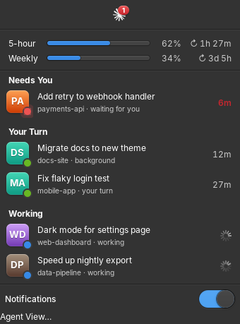
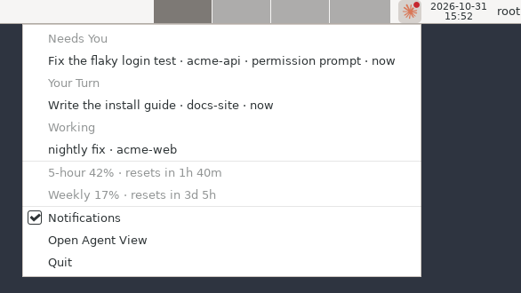
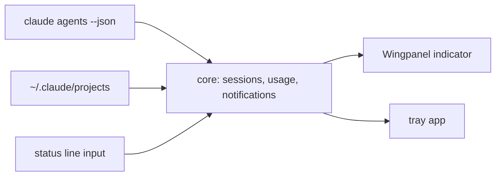

<div align="center">


# Claude Agents Indicator

See which Claude Code session is waiting on you, from your Linux panel.

[](https://elementary.io)
[](#tray-app)
[](https://launchpad.net/~k2ll33d2/+archive/ubuntu/claude-agents-indicator)
[](https://github.com/rezk2ll/claude-agents-indicator/releases/latest)
[](https://github.com/rezk2ll/claude-agents-indicator/actions/workflows/build.yml)
[](LICENSE)



</div>

Lists your live Claude Code sessions and tells you when one is waiting on you. You find out right away, not ten minutes later in some background tab.

It comes in two flavors:

- The Wingpanel indicator, for elementary OS and other Pantheon desktops.
- The tray app, for any desktop with a system tray: KDE Plasma, Ubuntu's GNOME, XFCE, Cinnamon, MATE, Budgie, LXQt, or waybar on Sway and Hyprland.

Unofficial. Not affiliated with Anthropic.

## Features

- Every live session in one list, interactive tabs and background agents alike, grouped into Needs You, Your Turn and Working.
- Each entry shows the conversation title, the project, and how long the session has been waiting.
- When a session needs you, the icon gets a badge and a notification pops up. It closes itself once you answer.
- Click a session, or its notification, to jump to its tab. Background sessions open in a new terminal with `claude attach`.
- A keyboard shortcut for the session that needs you: `claude-agents-tray --jump` (see [Jumping to a session](#jumping-to-a-session)).
- `claude-agents-status` for waybar, polybar, i3blocks or tmux (see [Status bars](#status-bars)).
- 5-hour and weekly usage with their reset times, read from your status line (see [Usage limits](#usage-limits)), and a notification when either reaches 80%.

## Install

Add the [PPA](https://launchpad.net/~k2ll33d2/+archive/ubuntu/claude-agents-indicator), so updates arrive with your system updates:

```sh
sudo add-apt-repository ppa:k2ll33d2/claude-agents-indicator
```

On elementary OS:

```sh
sudo apt install claude-agents-indicator
killall io.elementary.wingpanel
```

The panel restarts on its own.

### Tray app



On Ubuntu and other desktops:

```sh
sudo apt install claude-agents-tray
claude-agents-tray &
```

It starts on its own from the next login. On stock GNOME (not Ubuntu's), install the [AppIndicator extension](https://extensions.gnome.org/extension/615/appindicator-support/) first, since GNOME has no tray of its own.

Both packages are also attached to each [release](https://github.com/rezk2ll/claude-agents-indicator/releases/latest) as `.deb` files.

On Arch, build the tray app from the latest commit with the bundled PKGBUILD:

```sh
git clone https://github.com/rezk2ll/claude-agents-indicator
cd claude-agents-indicator/packaging/arch
makepkg -si
```

On Fedora, build an RPM of the latest release from the bundled spec:

```sh
sudo dnf install rpmdevtools dnf-plugins-core
git clone https://github.com/rezk2ll/claude-agents-indicator
cd claude-agents-indicator/packaging/fedora
rpmdev-setuptree
spectool -g -R claude-agents-tray.spec
sudo dnf builddep claude-agents-tray.spec
rpmbuild -bb claude-agents-tray.spec
sudo dnf install ~/rpmbuild/RPMS/*/claude-agents-tray-*.rpm
```

## Jumping to a session

The Wingpanel indicator raises the right tab in elementary Terminal.

The tray app selects the right tab when the session runs inside:

- tmux
- kitty, with `allow_remote_control yes` and `listen_on` set in `kitty.conf`
- WezTerm
- Ghostty 1.4 or later
- Konsole

It also brings the session's terminal window to the front on Sway, Hyprland, niri and KDE Plasma, and on X11 desktops when `xdotool` is installed. GNOME on Wayland lets no app raise another app's window, so the tray package ships a small GNOME Shell extension that does it. Turn it on once, then log out and back in:

```sh
gnome-extensions enable claude-agents@rezk2ll.github.io
```

Without it, the tab is still selected but the window stays where it is.

When none of this applies, clicking the session opens the agent view instead. Background sessions open in your default terminal (`xdg-terminal-exec`, or `x-terminal-emulator` on Debian and Ubuntu).

Bind `claude-agents-tray --jump` to a keyboard shortcut to do the same without the menu. It goes to the session that needs you, or else to one whose turn it is, or else opens the agent view. It starts the tray first if it is not running. The app's launcher entry offers the same as "Go to Waiting Session".

## Usage limits

Claude Code passes your 5-hour and weekly usage to the status line command. If you use [cctop](https://github.com/tomstagl/cctop) as your status line, it already works. Otherwise, save a copy of that input in `~/.claude/settings.json`, in front of your current status line command:

```json
{
  "statusLine": {
    "type": "command",
    "command": "tee \"$XDG_RUNTIME_DIR/claude-agents-status.json\" | your-current-command"
  }
}
```

With no status line yet, use `cat > "$XDG_RUNTIME_DIR/claude-agents-status.json"` as the command.

## Status bars

The tray package also ships `claude-agents-status`, which prints the sessions once and exits:

```sh
$ claude-agents-status
1 need you · 2 working
```

With `--waybar` it prints the JSON a [waybar custom module](https://github.com/Alexays/Waybar/wiki/Module:-Custom) reads: the waiting count as text (or the session count when none waits), the sessions and usage as the tooltip, and `attention`, `ready`, `working`, `idle` or `error` as the class. With usage set up, `{percentage}` is the higher of the 5-hour and weekly usage.

With `--follow` it keeps running and prints a new line whenever the sessions change, so waybar needs no interval:

```json
"custom/claude": {
  "exec": "claude-agents-status --waybar --follow",
  "return-type": "json",
  "format": "✻ {}"
}
```

Style `#custom-claude.attention` to make it stand out. The plain form fits polybar (`tail = true` with `--follow`), i3blocks or a tmux `status-right`.

## Requirements

- Claude Code with agent view (`claude agents --json`).
- For the indicator: elementary OS 8, or another distro running Pantheon (Wingpanel, Gala, elementary Terminal).
- For the tray app: a tray that speaks StatusNotifierItem, and libayatana-appindicator3.
- Optional: a status line set up as in [Usage limits](#usage-limits).

The indicator is tested on elementary OS 8. The tray app is built on Ubuntu, Debian, Fedora and Arch in CI and checked against a simulated tray host there.

## Build from source

Meson builds whichever front end has its dependencies installed. Force one with `-Dwingpanel=disabled` or `-Dtray=disabled`.

```sh
# Debian and Ubuntu; add libwingpanel-dev for the indicator
sudo apt install valac meson libgtk-3-dev libjson-glib-dev libayatana-appindicator3-dev
# Fedora
sudo dnf install vala meson gtk3-devel json-glib-devel libayatana-appindicator-gtk3-devel
# Arch
sudo pacman -S vala meson gtk3 json-glib libayatana-appindicator

meson setup build --prefix=/usr
ninja -C build
meson test -C build
sudo ninja -C build install
```

## How it works



- Sessions come from `claude agents --json`, polled every 3 seconds.
- Titles and last prompts are read from the session transcripts in `~/.claude/projects`.
- Each front end finds a session's tab from the variables its terminal exported to the session's process: `PANTHEON_TERMINAL_ID`, `TMUX_PANE`, `KITTY_WINDOW_ID`, `WEZTERM_PANE`, `GHOSTTY_SURFACE_ID` or `KONSOLE_DBUS_SESSION`. The tray app finds the window by walking up from the session's process to the terminal that owns it.
- Usage comes from the `rate_limits` field Claude Code passes to the status line. The freshest of `$XDG_RUNTIME_DIR/claude-agents-status.json` and cctop's files under `~/.cctop/status` wins.

## License

[GPL-3.0-or-later](LICENSE)

## Contributing

Bug reports and pull requests are welcome. See [CONTRIBUTING.md](CONTRIBUTING.md).
